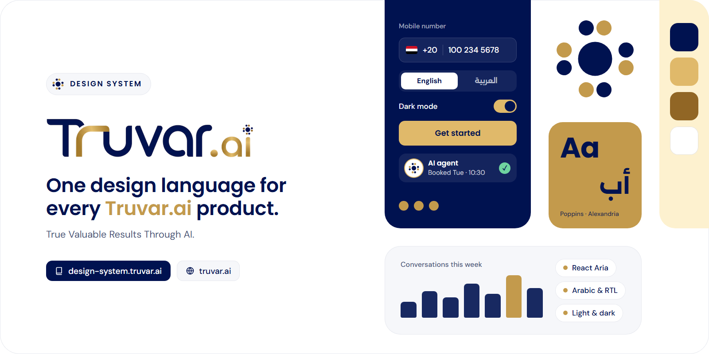

<p align="center">
  <a href="https://design-system.truvar.ai">
    
  </a>
</p>

<p align="center">
  <a href="https://design-system.truvar.ai"><b>Docs and showcase</b></a> ·
  <a href="https://truvar.ai">truvar.ai</a> ·
  <a href="https://www.npmjs.com/package/@truvar-ai/design-system">npm</a> ·
  <a href="https://github.com/truvar-ai/design-system/issues">Issues</a>
</p>

<p align="center">
  <a href="https://www.npmjs.com/package/@truvar-ai/design-system"></a>
  <a href="https://github.com/truvar-ai/design-system/actions/workflows/ci.yml"></a>
  <a href="LICENSE"></a>
</p>

# Truvar.ai Design System

The design system behind [Truvar.ai](https://truvar.ai): one set of design tokens and the React components built on them. Arabic-first with full right-to-left support, accessible by default on [React Aria](https://react-spectrum.adobe.com/react-aria/), and made to feel native on phones.

Browse every component, in English and Arabic, light and dark, at **[design-system.truvar.ai](https://design-system.truvar.ai)**.

## Highlights

- **Accessible by default:** keyboard, focus and screen reader behaviour come from React Aria.
- **Arabic and RTL:** layouts mirror with logical CSS properties; dates, numbers and keyboard arrows follow the locale.
- **Light and dark:** follows the system setting, or set it yourself.
- **Native on phones:** bottom sheets, a bottom tab bar, a push menu, finger-sized targets and no zoom on focus.
- **More than buttons:** international phone and country inputs, charts and maps, voice AI, a unified inbox and CRM, and an embeddable website assistant.
- **Small bundles:** heavy parts live behind their own import path, and unused components are removed by your bundler.

## Install

```sh
pnpm add @truvar-ai/design-system
```

Works with Next.js (App Router and Pages), Vite, Electron and any React 18 or 19 app.

```jsx
import "@truvar-ai/design-system/styles.css";
import { Button, TextField, PhoneField } from "@truvar-ai/design-system";

export function SignUp() {
  return (
    <form>
      <TextField label="Name" />
      <PhoneField label="Mobile" defaultCountry="EG" />
      <Button type="submit">Create account</Button>
    </form>
  );
}
```

Fonts, themes, Arabic setup and every import path are in the [package README](packages/design-system/README.md).

## What's included

| Import | What |
|---|---|
| `@truvar-ai/design-system` | Core components: buttons, fields, selects, dates, dialogs, sheets, menus, tables, toasts, cards, bottom nav, phone and country inputs, logo and brand marks |
| `@truvar-ai/design-system/icons` | UI icons and stateful system icons |
| `@truvar-ai/design-system/charts` | Charts, sparklines, gauges, heatmaps, funnels and a world map |
| `@truvar-ai/design-system/voice` | Call player, transcript, call logs, live call and workflow builder |
| `@truvar-ai/design-system/os` | Truvar OS kit: system bar, voice dock, agent task and approval cards |
| `@truvar-ai/design-system/crm` | Conversations across every channel, AI handoff, contacts, roles and permissions |
| `@truvar-ai/design-system/widget` | Website assistant: chat, voice notes and live voice calls that can book, fill forms and ask for approval |
| `@truvar-ai/design-system/tokens` | Design tokens as JS, CSS variables and JSON |

## Repository

```
tokens/                   Design tokens (DTCG .tokens.json), the source of truth for every package
packages/design-system/   @truvar-ai/design-system on npm
  src/core/               core components, phone and country inputs, flags
  src/brand/              logo, orbit mark, brand avatar, loader
  src/icons/              UI and system icons
  src/charts/             charts and maps
  src/voice/              call player, transcript, live call, workflow builder
  src/os/                 Truvar OS kit
  src/crm/                conversations, AI handoff, contacts, roles and permissions
  src/widget/             website assistant
apps/showcase/            internal playground: every component in English and Arabic, light and dark
apps/docs/                design-system.truvar.ai: landing page and docs (Next.js, static), built with the design system;
                          component pages reuse the showcase demos
```

**Coming next:** `packages/flutter` (`truvar_design_system` on pub.dev), `packages/mcp`, and `figma/` (Code Connect).

## Develop

Requires Node 20+ and pnpm 10.

```sh
pnpm install

pnpm showcase:dev     # the showcase with live reload: http://localhost:5173
pnpm showcase:build   # production build of the showcase
pnpm showcase:start   # serves that build: http://localhost:4173

pnpm docs:dev         # design-system.truvar.ai with live reload: http://localhost:3000
pnpm docs:build       # static site in apps/docs/out
pnpm docs:start       # serves that build: http://localhost:3001

pnpm build            # builds everything
pnpm lint             # checks the code (bugs, hook rules, accessibility)
```

**Tokens:** edit the files in `tokens/`, never the generated CSS. Light values live in `$value`, dark values in `$extensions["ai.truvar.modes"].dark`. `pnpm build` regenerates `tokens.css`, `tokens.json` and `tokens.js`.

**Releasing:** every pull request that changes the package adds a changeset (`pnpm changeset`). Versions and the changelog are generated from them, and CI checks that the changeset is there. See [Going to production](#going-to-production).

## Contributing

Issues and pull requests are welcome at [github.com/truvar-ai/design-system](https://github.com/truvar-ai/design-system/issues). Check new components in English and Arabic, light and dark, and at phone width before opening a pull request.

## Follow Truvar.ai

[Website](https://truvar.ai) · [LinkedIn](https://www.linkedin.com/company/truvar-ai) · [YouTube](https://www.youtube.com/@Truvar-d8b) · [Instagram](https://www.instagram.com/truvar.ai/) · [Facebook](https://www.facebook.com/truvar.ai.global) · [npm](https://www.npmjs.com/org/truvar-ai) · [business@truvar.ai](mailto:business@truvar.ai)

## License

[MIT](LICENSE) © [Truvar.ai](https://truvar.ai)

## Going to production

Do these once, in order. After that, the docs site updates on every push and new versions reach npm when you merge the release pull request.

### 1. Push the repo to the truvar-ai organisation

1. Sign in to GitHub as a member of `truvar-ai` who can create repositories.
2. Create an empty repository named `design-system` with **Owner** set to `truvar-ai`, and no README, .gitignore or license: [github.com/organizations/truvar-ai/repositories/new](https://github.com/organizations/truvar-ai/repositories/new). Or with the GitHub CLI: `gh repo create truvar-ai/design-system --public`.
3. From this folder:

   ```sh
   pnpm install
   pnpm lint && pnpm build      # make sure everything passes first
   git init -b main
   git add .
   git status                   # node_modules, dist, out and .next must not be listed
   git commit -m "Initial commit: Truvar.ai design system"
   git remote add origin https://github.com/truvar-ai/design-system.git
   git push -u origin main
   ```

4. Open the repository's **Actions** tab: **CI** (lint and build) should finish green.

### 2. Let the release workflow open pull requests

In the repository: **Settings → Actions → General → Workflow permissions**, choose **Read and write permissions**, tick **Allow GitHub Actions to create and approve pull requests**, and save.

### 3. Connect npm

1. Sign in to [npmjs.com](https://www.npmjs.com) with an account that's an owner of the [truvar-ai organisation](https://www.npmjs.com/org/truvar-ai).
2. Create a token: **avatar → Access Tokens → Generate New Token → Granular Access Token**. Give it **Read and write** on packages, limited to the `truvar-ai` organisation (or `@truvar-ai/design-system` once it exists), and an expiry date. Copy it.
3. In the GitHub repository: **Settings → Secrets and variables → Actions → New repository secret**, name `NPM_TOKEN`, paste the token.

The token is only ever used by the release workflow. Never paste it into code, issues or screenshots. When it expires, generate a new one and update the secret.

### 4. Publish to npm

Publishing always goes through the release workflow, so every version has a changelog, a GitHub release and an npm provenance badge (proof it was built from this repository). There is no manual `npm publish`.

1. The first push to `main` makes the **Release** workflow open a pull request named **Version packages**. It bumps the version (0.0.0 → **0.0.1** for the first release) and writes `packages/design-system/CHANGELOG.md` from the files in `.changeset/`.
2. Review it and merge it.
3. The workflow builds the package, publishes it to npm and creates a GitHub release. Check [npmjs.com/package/@truvar-ai/design-system](https://www.npmjs.com/package/@truvar-ai/design-system).

### 5. Put the docs online with Cloudflare Pages

1. In Cloudflare: **Workers & Pages → Create → Pages → Connect to Git**, and pick `truvar-ai/design-system`.
2. Build settings:

   | Setting | Value |
   |---|---|
   | Production branch | `main` |
   | Framework preset | None |
   | Build command | `pnpm docs:build` |
   | Build output directory | `apps/docs/out` |
   | Root directory | `/` |
   | Environment variable | `NODE_VERSION` = `22` |

3. Save and deploy, then add the custom domain under **Custom domains**: `design-system.truvar.ai`.
4. Let search engines and AI assistants read the site. In the Cloudflare dashboard, open the `truvar.ai` zone, then **Security → Bots**:
   - turn **Block AI bots** off;
   - set **Manage your robots.txt** (AI crawler control) to off, so Cloudflare doesn't replace the site's own `robots.txt`;
   - leave **Bot Fight Mode** off for this hostname, or crawlers may get a challenge page instead of the content.

   Cloudflare turns some of these on by default for new sites. Left on, they block ChatGPT, Claude, Perplexity and Google's AI from the docs.
5. Check the live site: [design-system.truvar.ai/robots.txt](https://design-system.truvar.ai/robots.txt) lists every crawler as allowed, and [/llms.txt](https://design-system.truvar.ai/llms.txt) opens as text.
6. Submit the sitemap, `https://design-system.truvar.ai/sitemap.xml`, in [Google Search Console](https://search.google.com/search-console) and [Bing Webmaster Tools](https://www.bing.com/webmasters) (Bing also feeds ChatGPT search and Copilot).

From then on, every push to `main` updates the site, and every pull request gets its own preview link.

### What the docs site does for search engines and AI assistants

- **Every page is plain HTML,** including the live examples, so crawlers that don't run JavaScript (most AI crawlers) read the full content.
- **Both languages:** each English page links to its Arabic twin (`hreflang`), with its own title, description and canonical address.
- **Structured data (JSON-LD):** Truvar.ai as the organisation with its social profiles, the website, the npm package, each docs page as a technical article, and breadcrumbs.
- **For AI assistants:** [`/llms.txt`](https://design-system.truvar.ai/llms.txt) (an index of every page), [`/llms-full.txt`](https://design-system.truvar.ai/llms-full.txt) (the whole English documentation in one file) and [`/ar/llms-full.txt`](https://design-system.truvar.ai/ar/llms-full.txt) (Arabic), plus a Markdown copy of every page at `<page>/index.md`. They're generated from the built pages on every build, so they never go out of date.
- **`robots.txt`** allows every crawler and names the AI crawlers explicitly; **`sitemap.xml`** lists every page in both languages.
- **Speed:** fonts are served from the site itself, each page loads only its own example code, and the built files are cached for a year.

Lighthouse: 100 for SEO, accessibility and best practices on every page tested, in both languages and both themes. Re-check after big changes with `npx lighthouse https://design-system.truvar.ai/ --only-categories=seo`.

### Every release after that

```sh
# 1. make your change on a branch
git checkout -b my-change

# 2. describe it for the changelog: pick patch (fix), minor (new feature) or major (breaking change)
pnpm changeset

# 3. check, commit, push and open a pull request
pnpm lint && pnpm build
git add . && git commit -m "Describe the change"
git push -u origin my-change
```

Merge the pull request once CI is green. The **Version packages** pull request then updates itself; merge it whenever you want to release, and the new version goes to npm. Apps using the package update with `pnpm up @truvar-ai/design-system@latest`.
